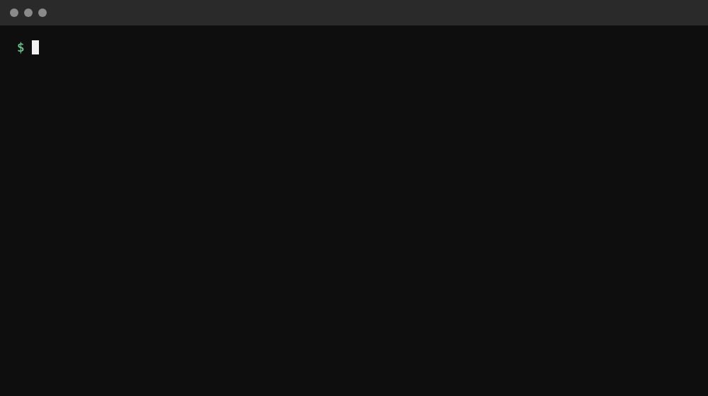

<div align="center">

# Woolly

**Memory that knows when it's wrong.**

Woolly flags lines in CLAUDE.md, AGENTS.md, Cursor rules and agent memory that a commit made wrong, with the commit that did it. Local, no model, free and open source.

[](https://github.com/rjcuff/woolly/releases/latest)
[](LICENSE)
[](https://github.com/rjcuff/woolly/actions/workflows/ci.yml)
[](https://github.com/rjcuff/woolly/stargazers)

[Website](https://usewoolly.com) · [Docs](https://usewoolly.com/docs) · [Download for Mac and Windows](https://usewoolly.com/download) · [Changelog](CHANGELOG.md) · [Contributing](CONTRIBUTING.md) · [Glama](https://glama.ai/mcp/servers/@rjcuff/woolly)



</div>

## Try it on your repo

```sh
curl -fsSL https://usewoolly.com/install.sh | sh
cd your-repo
woolly check
```

No setup, no account, no model. Woolly reads CLAUDE.md and the files it imports, AGENTS.md, Claude Code rules, skills and subagents, Cursor, Windsurf and Cline rules, Copilot instructions, Claude Code's auto memory, Codex memories and claude-mem, and flags every line that names a function, file or script the code no longer has, with the commit that changed it.

```
Checked 56 lines in AGENTS.md and .github/copilot-instructions.md against 20b0427.
  .github/copilot-instructions.md:30  Also update: `src/shared/api.ts`, `src/shared/providers/providers.json`
    src/shared/providers/providers.json was moved to apps/vscode/src/shared/providers/providers.json in 791d23899 (2026-05-25)
1 line names code that's gone. Your agents still read it as true.
```

`woolly check --fix` rewrites renamed names and moved paths for you. On Windows, install with `irm https://usewoolly.com/install.ps1 | iex`. [Check your agent files](https://usewoolly.com/docs/memory-files)

## The problem

Your agents follow the notes you give them. CLAUDE.md, AGENTS.md, Cursor rules and memory tools like claude-mem all keep repeating facts the code stopped backing up weeks ago, and nothing checks them. A refactor renames a function, the note keeps the old name, and your agent follows it with confidence.

Switching between Claude Code, Cursor and Codex makes it worse. Each one starts from zero, so you explain the same gotchas again, or write them into notes that go stale.

Woolly is project memory your coding agents can trust. It runs on your machine, and it knows when a fact goes stale. Every fact points at the file, function or lines it's about. When that code changes, Woolly marks the fact stale instead of letting your agent follow it.

## Use it in every session

```sh
woolly connect
woolly init --hooks   # in your repo
```

Claude Code, Cursor, Codex, Gemini CLI, VS Code, Windsurf, Claude Desktop, LM Studio, opencode and AnythingLLM now share one memory for the repo, and every commit checks it against the code. Each session starts with the lines that went out of date, so the agent knows not to follow them.

Using Claude Code? After installing `woolly`, you can add it as a plugin instead of running `woolly connect`.

```sh
claude plugin marketplace add rjcuff/woolly
claude plugin install woolly@woolly
```

Prefer an app? [Download Woolly for Mac or Windows](https://usewoolly.com/download). Also on [Homebrew and Linux](https://usewoolly.com/docs/quickstart).

## What you get

**It knows when a fact goes stale.** On every commit and on `woolly check`, each fact is checked against the code it points at. Rename a function, delete a file or change a pin number, and the fact that relied on it is flagged with the commit that broke it. `woolly review` lets you confirm, fix or retire it. [Stale facts](https://usewoolly.com/docs/stale-facts)

**`woolly why` explains any line.** Point it at a file, a line or a function and it shows the decisions and gotchas behind it, what was rejected, and whether the code still backs each one up. Agents ask it too before changing code. [Why is this code like this](https://usewoolly.com/docs/why)

**Pull requests say what they break.** A GitHub Action comments when a change makes a project fact stale, so the whole team sees it before it merges. [Pull request checks](https://usewoolly.com/docs/pull-requests)

**Every fact cites its source.** A file, function or line range, the commit it was saved at, and the session it came from.

**One memory for every agent on the repo.** Claude Code, Cursor and Codex read and update the same notes, and teammates get them through git. [Project memory](https://usewoolly.com/docs/project-memory)

**Sessions that start warm.** Each session opens with a short brief with the project's current facts, where you left off, and which facts were kept out because the code changed. `woolly caught` counts every one, with a badge for your README. [Connect](https://usewoolly.com/docs/connect)

**Decisions stick.** When a session ends, Woolly saves what you decided, why, and what you ruled out, so no agent pitches it again.

**Facts keep their history.** Nothing is deleted. A replaced or stale fact stays on disk with the date it stopped being true. When an AI contradicts something you said, your version wins.

**It dreams.** While you're away, your local model merges duplicates, settles facts that changed, and turns past sessions into lessons. The next session starts with what it did, and `woolly recap` shows it too. [Dreaming](https://usewoolly.com/docs/dreaming)

**Fully local.** No cloud, no account, no telemetry. Ollama is optional, and stale detection never needs a model. Passwords and API keys are refused, and an AI can't plant instructions in your memory. [Security](https://usewoolly.com/docs/security)

**Memory you can read.** Every memory is a Markdown file. Open it, grep it, edit it by hand, and see which tool saved it. [The app](https://usewoolly.com/docs/review)

### Also in Woolly

- **Personal memory** that follows you across every AI app. [How it works](https://usewoolly.com/docs/how-it-works)
- **Memory for the agents you build**, with an API shaped like mem0's and Python and JavaScript packages. Save preferences, procedures and episodes, link related memories, and rate what helped so search gets better. Each app user's memory stays apart from yours. [Memory API](https://usewoolly.com/docs/memory-api)
- **Memory for Ollama** and any OpenAI or Anthropic app, with `woolly proxy`. [Proxy](https://usewoolly.com/docs/proxy)
- **Import** your ChatGPT or Claude history, and **sync** your machines over your own network. [Import](https://usewoolly.com/docs/import) · [Sync](https://usewoolly.com/docs/sync)

## Your team's agents share one project memory

```sh
woolly init
```

Run it in a repo and commit `.woolly/`. The first time, it brings in what your CLAUDE.md, AGENTS.md and Cursor rules already say, and points those facts at the code. Every teammate's agent now reads and updates the same notes on the stack, conventions, decisions, gotchas and commands. Think of it as a CLAUDE.md that keeps itself up to date and checks itself against the code.

- One fact per line in `.woolly/woolly.md`, so diffs are readable and you can edit it by hand.
- Facts about you never go in the repo.
- Two people adding facts at once don't conflict.

[Project memory](https://usewoolly.com/docs/project-memory)

## Woolly Team

[Woolly Team](https://usewoolly.com/team) is an optional GitHub App that watches every repository in your organization and shows stale agent notes in one review queue. It reads results from the checks you run in your own GitHub Actions, never your memories or code.

| Plan | Price | Private repositories |
| --- | --- | --- |
| Free | $0 | 1, plus unlimited public |
| Team | $99 a month | 10 |
| Business | $299 a month | 50, with a weekly Slack digest |
| Enterprise | Custom | Unlimited, invoiced yearly |

One flat price per organization, no per-seat fees. The open source check stays free in every plan.

## Tested on real repos

We ran `woolly check` on the agent files of 20 well-known open source repos, 2,990 lines in all. It flagged 11 lines in 4 repos, and all 11 named code that really was gone. The median check took 0.67 seconds. [Run it yourself](bench/RESULTS.md)

On 50 scripted changes to a small drone firmware repo, Woolly flagged 28 of the 30 facts that went stale, with no false alarms. Its search also does well on the [LOCOMO](https://github.com/snap-research/locomo) long-conversation benchmark. [Benchmarks](https://usewoolly.com/docs/benchmark)

## Questions

**Do I need Ollama?** No. Woolly works on its own, and stale detection never needs a model. With Ollama running, it also searches by meaning and picks out decisions and gotchas when a session ends.

**How is this different from other memory tools?** Most remember what a conversation said. Woolly also checks it against the code. Every project fact cites its source, and when the code changes, the fact is flagged instead of trusted. It runs on your own machine with no cloud, works with every agent at once, and uses a local model only. Some agents can now audit their own instruction files with a model, inside one session. Woolly needs no model, names the commit that broke each line, fixes renames with `--fix`, runs in CI on every pull request, and also reads Codex memories and claude-mem.

**Is this a memory API for my app?** It has one, shaped like mem0's, with [JavaScript](https://usewoolly.com/docs/javascript) and [Python](https://usewoolly.com/docs/python) packages. But Woolly is built first for your own coding agents. If you're adding memory to a product with thousands of users, a hosted memory API is the better fit.

**Does anything leave my machine?** No. The Woolly app has no servers. [Woolly Team](https://usewoolly.com/team) is a separate, optional hosted service for organizations, and it receives counts, file pointers and repository details like names and commits from checks you run in your own GitHub Actions, never your memories or code.

## Built in public

Woolly ships weekly, and every release is in the [changelog](CHANGELOG.md). Issues, ideas and pull requests are welcome. [CONTRIBUTING.md](CONTRIBUTING.md) explains how the repo is laid out and how to run the tests.

If `woolly check` found a line your agent was still following, a star helps other people find it.

- [Docs](https://usewoolly.com/docs) and [all commands](https://usewoolly.com/docs/cli)
- [Security](SECURITY.md)
- [LinkedIn](https://www.linkedin.com/company/usewoolly)

MIT license.
